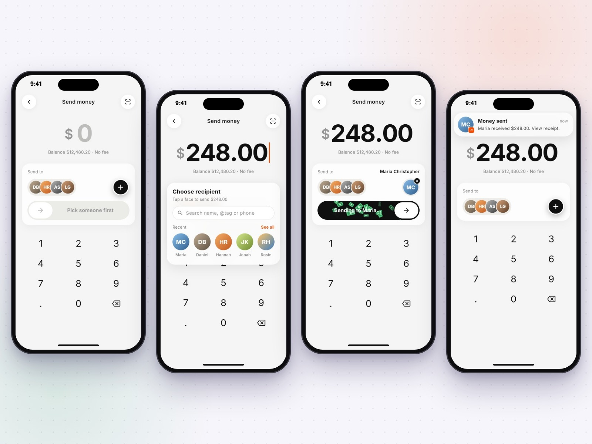

# Send Money App UI in Flutter

A smooth send money flow for a fintech app, built with Flutter. Type an amount on a custom keypad, pick a
contact from a card that grows out of the + button, then swipe to send. Green bills fly across the button,
it turns into "Sent to Maria", and a "Money sent" notification slides out of the header.

🌐 **Live demo:** https://yaqoobdeveloper.github.io/Send-Money-App-UI-in-Flutter/

🔒 **Full source code:** available to members of the Flutter Source Club: https://yaqoobdeveloper.com/pro

📺 **YouTube Short:** https://youtube.com/shorts/Nfq3YLj7Wnk

📺 **More Flutter UI:** https://www.youtube.com/@yaqoob_developer

This repository only hosts the live demo. It does not contain the source code.
